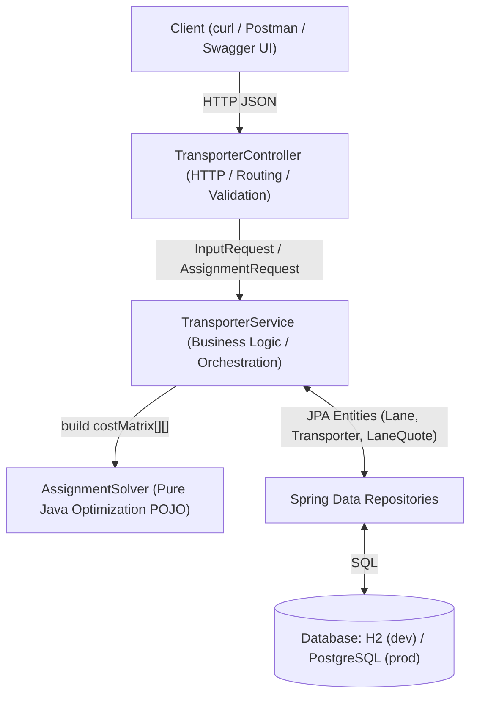

# Transporter Assignment on Lanes: Algorithm, API Architecture & Build Guide

---

## Table of Contents
1. [Problem Statement & Business Objectives](#1-problem-statement--business-objectives)
2. [The Optimization Algorithm in Depth](#2-the-optimization-algorithm-in-depth)
   - [Why Simple Greedy Fails (The Greedy Trap)](#why-simple-greedy-fails-the-greedy-trap)
   - [Combinatorial Space: Subsets vs Combinations](#combinatorial-space-subsets-vs-combinations)
   - [Bitmask Enumeration vs Recursion](#bitmask-enumeration-vs-recursion)
   - [The Bit-Testing Mechanism](#the-bit-testing-mechanism)
   - [Core Algorithm Code](#core-algorithm-code)
   - [Step-by-Step Dry Run on Sample Data](#step-by-step-dry-run-on-sample-data)
   - [Feasibility Pre-Check & Complexity](#feasibility-pre-check--complexity)
3. [API Architecture & Request Flow](#3-api-architecture--request-flow)
   - [Layered Architecture](#layered-architecture)
   - [Endpoint 1: POST /api/v1/transporters/input](#endpoint-1-post-apiv1transportersinput)
   - [Endpoint 2: POST /api/v1/transporters/assignment](#endpoint-2-post-apiv1transportersassignment)
   - [Error Handling & HTTP Status Codes](#error-handling--http-status-codes)
4. [Build, Run & Deployment](#4-build-run--deployment)
   - [Prerequisites](#prerequisites)
   - [Local Build & Execution](#local-build--execution)
   - [Docker Deployment](#docker-deployment)
   - [Database Configuration (H2 vs PostgreSQL)](#database-configuration-h2-vs-postgresql)

---

## 1. Problem Statement & Business Objectives

### The Business Context
In freight logistics, shippers manage multiple shipping routes across regions (**"Lanes"**, e.g., *Mumbai $\rightarrow$ Delhi*, *Pune $\rightarrow$ Hyderabad*). Third-party logistics carriers (**"Transporters"**) bid on these lanes by submitting price quotes.

While a shipper wants to minimize shipping costs, managing contracts with too many individual transporters causes operational friction, administrative overhead, and vendor risk. Therefore, management enforces a hard constraint: **contract with at most $k$ distinct transporters**.

### The Three Core Objectives
1. **100% Lane Coverage**: Every single lane must be assigned to exactly one transporter who provided a valid quote for that lane.
2. **Transporter Cap ($k$)**: The total count of unique transporters used across all lanes must be $\le k$.
3. **Cost Minimization**: Out of all transporter teams of size $\le k$ that achieve full coverage, select the team and assignments that yield the minimum total cost.

---

## 2. The Optimization Algorithm in Depth

### Why Simple Greedy Fails (The Greedy Trap)

Consider 4 lanes and 5 transporters with quotes:

| Lane | $t_1$ | $t_2$ | $t_3$ | $t_4$ | $t_5$ |
|---|:---:|:---:|:---:|:---:|:---:|
| **Lane 0 (`m->d`)** | 10 | **5** | 15 | 25 | 20 |
| **Lane 1 (`m->g`)** | 10 | 10 | 15 | **5** | 22 |
| **Lane 2 (`g->d`)** | 15 | **5** | 25 | 20 | **5** |
| **Lane 3 (`d->g`)** | 20 | 15 | 5 | 22 | **3** |

#### Scenario: $k = 2$ transporters
* **Greedy Intuition:** A developer looks at individual lane minimums. $t_2$ wins Lane 0 and Lane 2 (quote 5), while $t_4$ wins Lane 1 (quote 5). Selecting team $\{t_2, t_4\}$ gives:
  $$\text{Lane 0}(5) + \text{Lane 1}(5) + \text{Lane 2}(5) + \text{Lane 3}(15) = \mathbf{30}$$
* **Global Optimization:** Selecting team $\{t_2, t_5\}$ gives:
  $$\text{Lane 0}(5) + \text{Lane 1}(10) + \text{Lane 2}(5) + \text{Lane 3}(3) = \mathbf{23}$$

> [!NOTE]
> Taking a small compromise on Lane 1 ($+5$ to use $t_2$) unlocks a massive saving on Lane 3 ($-12$ to use $t_5$). The greedy approach gets trapped at 30, whereas global combinatorial evaluation finds the true minimum of **23**.

---

### Combinatorial Space: Subsets vs Combinations

* **Total possible subsets of $n$ transporters:**
  $$2^n \quad (\text{For } n = 5, 2^5 = 32 \text{ subsets})$$
* **Total combinations allowed under "at most $k$":**
  $$\text{Valid Teams} = \sum_{r=1}^{k} \binom{n}{r} = {}^nC_1 + {}^nC_2 + \dots + {}^nC_k$$
  For $n = 5$ and $k = 3$:
  $${}^5C_1 + {}^5C_2 + {}^5C_3 = 5 + 10 + 10 = \mathbf{25\text{ valid combinations}}$$

---

### Bitmask Enumeration vs Recursion

Instead of recursive backtracking (which introduces call stack overhead, stack frames, and continuous list allocations), the algorithm uses **Bitmask Enumeration** in an iterative loop:

```java
for (int mask = 1; mask < (1 << n); mask++) {
    if (Integer.bitCount(mask) > effectiveK) continue;
    // evaluate team...
}
```

* `(1 << n)` shifts binary 1 left by $n$ places, equaling $2^n$.
* Counting `mask` from $1$ to $2^n - 1$ sequentially enumerates every non-empty subset of transporters.
* `Integer.bitCount(mask)` compiles directly to the x86 assembly `POPCNT` instruction (1 clock cycle). If the team size exceeds $k$, it is discarded immediately.

---

### The Bit-Testing Mechanism

To determine whether transporter index $t$ is included in the current candidate team `mask`:

```java
if ((mask & (1 << t)) == 0) continue;
```

* `(1 << t)` creates a binary probe with a `1` only at position $t$.
* Bitwise AND `&` checks if `mask` also has a `1` at position $t$:
  * If `(mask & (1 << t)) != 0` $\rightarrow$ Transporter $t$ **is in the team**.
  * If `(mask & (1 << t)) == 0` $\rightarrow$ Transporter $t$ **is benched**, skip quote.

---

### Core Algorithm Code

```java
long bestCost = Long.MAX_VALUE;
int bestUsed = -1;
int[] bestAssignment = null;

// 1. Enumerate all 2^n transporter subsets
for (int mask = 1; mask < (1 << n); mask++) {
    
    // Prune: Skip combinations exceeding max transporters
    if (Integer.bitCount(mask) > effectiveK) continue;

    long totalCost = 0;
    int[] assignment = new int[L];
    boolean feasible = true;

    // 2. For each lane, pick the cheapest quote from this active team
    for (int l = 0; l < L; l++) {
        long minCost = Long.MAX_VALUE;
        int chosenT = -1;

        for (int t = 0; t < n; t++) {
            if ((mask & (1 << t)) == 0) continue; // Transporter not on team

            if (costMatrix[t][l] != Long.MAX_VALUE && costMatrix[t][l] < minCost) {
                minCost = costMatrix[t][l];
                chosenT = t;
            }
        }

        // If no one in this team quoted this lane, team cannot cover 100% of lanes
        if (chosenT == -1) { 
            feasible = false; 
            break; 
        }

        assignment[l] = chosenT;
        totalCost += minCost;
    }

    if (!feasible) continue;

    // 3. Count transporters that actually won at least one lane
    Set<Integer> usedSet = new HashSet<>();
    for (int val : assignment) usedSet.add(val);
    int used = usedSet.size();

    // 4. Update global winner (primary: lowest cost, tie-breaker: more vendors)
    if (totalCost < bestCost || (totalCost == bestCost && used > bestUsed)) {
        bestCost = totalCost;
        bestUsed = used;
        bestAssignment = assignment.clone();
    }
}
```

---

### Step-by-Step Dry Run on Sample Data

**Configuration:** $L = 2$ Lanes, $n = 3$ Transporters ($t_0, t_1, t_2$), $k = 2$.
**Quotes:**
* $t_0$: Lane 0 = 10, Lane 1 = 20
* $t_1$: Lane 0 = 15, Lane 1 = 5
* $t_2$: Lane 0 = 30, Lane 1 = *No quote* ($\infty$)

| `mask` | Binary | Team | `bitCount` | Evaluation | Feasibility / Cost | Action |
|:---:|:---:|:---:|:---:|---|:---:|---|
| **1** | `001` | $\{t_0\}$ | 1 ($\le 2$) | Lane 0: $t_0(10)$, Lane 1: $t_0(20)$ | Feasible: Cost = **30** | `bestCost = 30` |
| **2** | `010` | $\{t_1\}$ | 1 ($\le 2$) | Lane 0: $t_1(15)$, Lane 1: $t_1(5)$ | Feasible: Cost = **20** | `bestCost = 20` |
| **3** | `011` | $\{t_0, t_1\}$ | 2 ($\le 2$) | Lane 0: $\min(10, 15)=10$, Lane 1: $\min(20, 5)=5$ | Feasible: Cost = **15** | `bestCost = 15` *(Winner)* |
| **4** | `100` | $\{t_2\}$ | 1 ($\le 2$) | Lane 0: $t_2(30)$, Lane 1: $\infty$ | **Infeasible** (`chosenT == -1`) | Discarded |
| **5** | `101` | $\{t_0, t_2\}$ | 2 ($\le 2$) | Lane 0: $\min(10, 30)=10$, Lane 1: $t_0(20)$ | Feasible: Cost = **30** | Discarded ($30 > 15$) |
| **6** | `110` | $\{t_1, t_2\}$ | 2 ($\le 2$) | Lane 0: $\min(15, 30)=15$, Lane 1: $t_1(5)$ | Feasible: Cost = **20** | Discarded ($20 > 15$) |
| **7** | `111` | $\{t_0, t_1, t_2\}$ | 3 ($> 2$) | `bitCount > k` | **Pruned** | Skipped via `continue` |

---

### Feasibility Pre-Check & Complexity

1. **Pre-Check (`computeMinTransportersNeeded`)**:
   Before the main loop, the solver determines the minimum number of transporters needed just to cover all lanes. If $\text{minNeeded} > k$, it throws `InfeasibleException` (HTTP 422) immediately without executing the full enumeration.
2. **Time Complexity**: $\mathcal{O}(2^n \times L \times n)$
   * $n$: Number of transporters
   * $L$: Number of lanes
3. **Safety Guard**: If $n > 20$, the solver rejects the request with an exception. Beyond $n = 20$ ($2^{20} \approx 10^6$), an Integer Linear Programming (ILP) solver is recommended.

---

## 3. API Architecture & Request Flow

### Layered Architecture



---

### Endpoint 1: POST /api/v1/transporters/input

Ingests lanes and transporter quotes. This operation is **atomic** and replaces any existing dataset.

#### Request: `POST /api/v1/transporters/input`
```json
{
  "lanes": [
    {"id": 1, "origin": "Mumbai", "destination": "Delhi"},
    {"id": 2, "origin": "Delhi", "destination": "Bangalore"}
  ],
  "transporters": [
    {
      "id": 1,
      "name": "Transporter T1",
      "laneQuotes": [
        {"laneId": 1, "quote": 10000},
        {"laneId": 2, "quote": 15000}
      ]
    },
    {
      "id": 2,
      "name": "Transporter T2",
      "laneQuotes": [
        {"laneId": 1, "quote": 9000},
        {"laneId": 2, "quote": 16000}
      ]
    }
  ]
}
```

#### Response: `200 OK`
```json
{
  "status": "success",
  "message": "Input data saved successfully."
}
```

---

### Endpoint 2: POST /api/v1/transporters/assignment

Computes and returns the optimal assignment subject to `maxTransporters`.

#### Request: `POST /api/v1/transporters/assignment`
```json
{
  "maxTransporters": 2
}
```

#### Response: `200 OK`
```json
{
  "status": "success",
  "totalCost": 24000,
  "assignments": [
    {"laneId": 1, "transporterId": 2},
    {"laneId": 2, "transporterId": 1}
  ],
  "selectedTransporters": [1, 2]
}
```

---

### Error Handling & HTTP Status Codes

The API uses `GlobalExceptionHandler` to produce standardized error responses:

| Status Code | Reason | Example Scenario |
|:---:|---|---|
| **`400 Bad Request`** | Input validation failure | Negative quotes, duplicate IDs, missing required fields, or $n > 20$. |
| **`409 Conflict`** | State conflict | Calling `/assignment` before submitting data to `/input`. |
| **`422 Unprocessable Entity`** | Infeasible request | Asking for $k = 2$ when lanes require at least 3 distinct transporters to be covered. |

---

## 4. Build, Run & Deployment

### Prerequisites
* **Java**: OpenJDK 17 or higher
* **Build Tool**: Apache Maven 3.9+
* **Docker** (optional for containerized execution)

---

### Local Build & Execution

#### 1. Compile and Package
```bash
mvn clean package
```

#### 2. Run the Application
```bash
# Direct Maven run:
mvn spring-boot:run

# Or run the packaged Fat JAR:
java -jar target/transporter-assignment-0.0.1-SNAPSHOT.jar
```
The application starts on **`http://localhost:8080`**.

#### 3. Interactive Documentation
* **Swagger UI:** `http://localhost:8080/swagger-ui.html`
* **Health Check:** `http://localhost:8080/health`

---

### Docker Deployment

#### 1. Build the Docker Image
```bash
docker build -t transporter-assignment:latest .
```

#### 2. Run Container
```bash
docker run -p 8080:8080 transporter-assignment:latest
```

---

### Database Configuration (H2 vs PostgreSQL)

By default, the application runs an in-memory **H2 database** (`application.yml`) for rapid local development and testing.

To connect to a production **PostgreSQL database**, activate the `prod` Spring profile via environment variables:

| Environment Variable | Description | Example |
|---|---|---|
| `SPRING_PROFILES_ACTIVE` | Active profile | `prod` |
| `DB_URL` | JDBC Connection String | `jdbc:postgresql://localhost:5432/transporterdb` |
| `DB_USERNAME` | Database User | `postgres` |
| `DB_PASSWORD` | Database Password | `secretpassword` |

