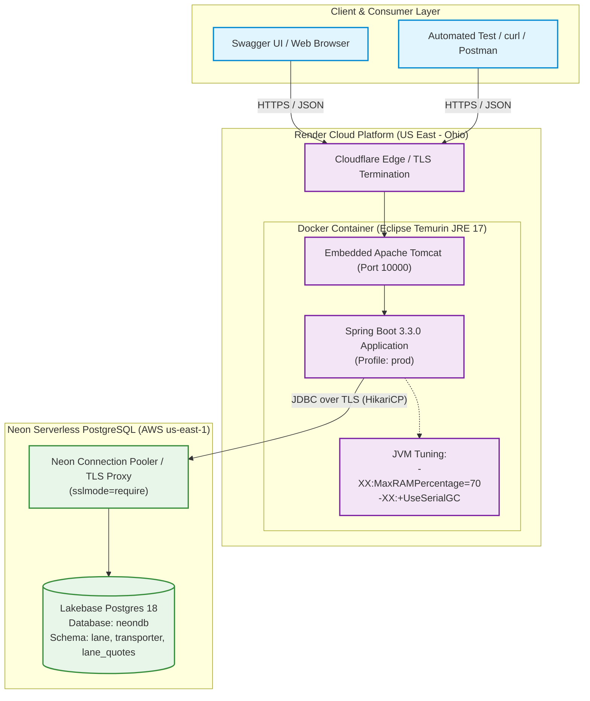
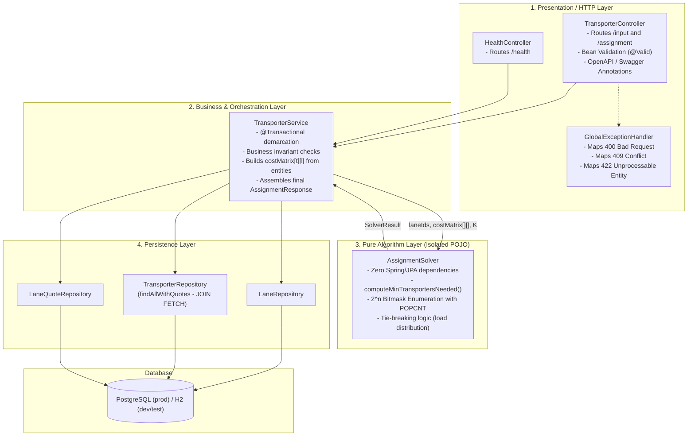
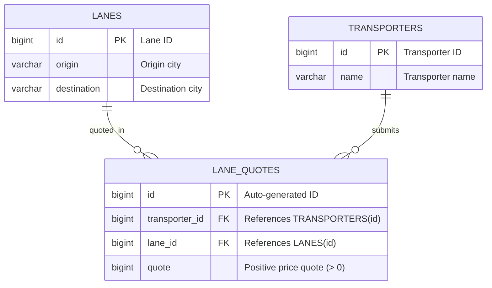

# System & Software Architecture Diagrams
**Project:** Transporter Assignment on Lanes API  
**Author:** Harshit Soni  

You can use these diagrams in your Loom walkthrough, GitHub README, or design discussions.

---

## 1. High-Level Cloud & Infrastructure Architecture

This diagram shows how requests flow from the client across the public internet through Render's edge down to Neon Serverless PostgreSQL.



---

## 2. Software Layer Architecture (Separation of Concerns)

This diagram highlights the clean 4-tier modular decoupling in your Java codebase.



---

## 3. End-to-End Sequence Diagram: `/assignment` Request

This diagram illustrates how an assignment request is validated, loaded from the database, optimized by the solver, and returned.

```mermaid
sequenceDiagram
    autonumber
    actor Client as Client (Swagger / curl)
    participant C as TransporterController
    participant V as Hibernate Validator
    participant S as TransporterService
    participant R as TransporterRepository
    participant Opt as AssignmentSolver
    participant DB as Neon PostgreSQL

    Client->>C: POST /api/v1/transporters/assignment {"maxTransporters": 3}
    C->>V: Validate @Min(1)
    V-->>C: Validated OK
    
    C->>S: computeAssignment(request)
    S->>R: findAllWithQuotes()
    R->>DB: SELECT t FROM Transporter t LEFT JOIN FETCH t.laneQuotes
    DB-->>R: Transporter & Quote entities
    R-->>S: List<Transporter>
    
    Note over S: Builds sorted costMatrix[transporter][lane]
    
    S->>Opt: solve(laneIds, transporterIds, costMatrix, k=3)
    
    alt Infeasible (minNeeded > k)
        Opt-->>S: throw InfeasibleException(minNeeded)
        S-->>C: Bubble up
        C-->>Client: 422 Unprocessable Entity {"message": "Minimum required: 3"}
    else Feasible Solution Found
        Note over Opt: Bitmask loop (1 to 2^n)<br/>Prune if popcount > k<br/>Per-lane min cost & tie-breaker
        Opt-->>S: SolverResult(totalCost=7500, assignments, selectedTransporters)
        S-->>C: AssignmentResponse DTO
        C-->>Client: 200 OK {"status": "success", "totalCost": 7500, ...}
    end
```

---

## 4. Entity-Relationship (ER) Schema

This diagram visualizes the database tables and relational constraints in PostgreSQL.


